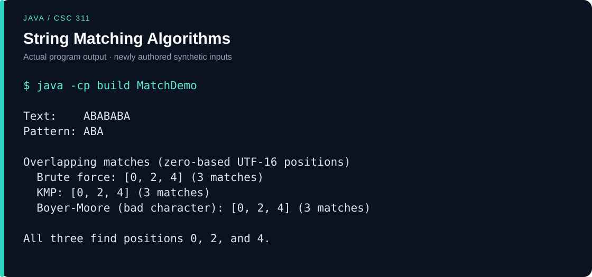

# String Matching Algorithms

A Java Swing coursework tool comparing brute-force, Knuth-Morris-Pratt (KMP), and Boyer-Moore bad-character string matching. It reports overlapping match positions and elapsed time.

## Example walkthrough

With text `ABABABA` and pattern `ABA`, all three algorithms report positions **0, 2, and 4**, including overlapping matches. Positions use zero-based Java UTF-16 indices.



Run from the repository root. For Java, create `build` if it does not already exist:

```sh
mkdir build
javac --release 8 -encoding UTF-8 -d build src/*.java examples/*.java
java -cp build MatchDemo
```

[Runnable example](examples/) · [Plain-text output](examples/output.txt)

The example and output visual were added for this portfolio in November 2026 using newly authored synthetic inputs. They are separate from the original coursework.

### Try the Swing interface

Launch `java -cp build StringMatching`, select **KMP**, enter `ABABABA` in **String Text** and `ABA` in **Pattern Text**, then choose **Find Substring**. Expect three matches at positions 0, 2, and 4. The displayed duration varies by machine and is not a controlled benchmark.

## Course and original date

- **Course / المادة:** CSC 311 - Algorithms Design and Analysis / تصميم وتحليل الخوارزميات, King Saud University.
- **Original project period / تاريخ المشروع الأصلي:** January-February 2023.
- **Evidence:** The original course brief identifies the second semester of 1444 and a deadline of 2 February 2023. The report is dated 27 January and the selected Eclipse `project311` source was last modified on 6 February 2023; the deadline is not presented as the last implementation date.

The original coursework dates above are distinct from the GitHub publication and maintenance date, **9 November 2026**. The original source files were preserved locally.

## Run

JDK 11 or newer with `javac` and `java` on PATH; Java 8-compatible output. No external Java dependencies.

```sh
mkdir build
javac --release 8 -encoding UTF-8 -d build src/*.java
java -cp build StringMatching
```

## Verification

```sh
python check.py
```

1,524 comparisons against Java string-search results passed, covering overlaps, repeated-character fallback, empty/long patterns, Arabic, emoji, and seeded random cases. The GUI was compiled; its visual interaction was not exercised. Checks use newly authored synthetic inputs only. See [CHANGES.md](CHANGES.md) for the publication changes and validation scope.

## Scope and provenance

Positions use Java UTF-16 character indices. The GUI timer is an informal measurement, not a controlled benchmark. Boyer-Moore uses the bad-character heuristic only.

Published from the owner's local coursework. Course briefs, slides, exams, student identifiers, faculty names, real datasets, collected email, credentials, IDE history, and compiled files are excluded. Academic material may include supplied interfaces or collaborative code; no claim of sole authorship of all scaffolding and no blanket license is made.

Course titles are cross-checked against the [KSU computer science course catalog](https://ccis.ksu.edu.sa/en/cs/cs-prog-guides). Original local evidence is retained privately rather than publishing the source briefs/reports.
